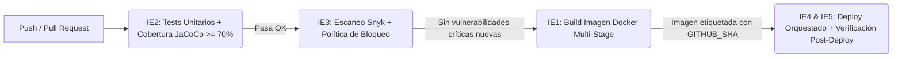

# 🚀 Microservicio de Facturación (Caso 02 - TalentoYa) — Pipeline CI/CD (EP2 DOY0101)

Repositorio correspondiente a la **Evaluación Parcial N°2** de la asignatura **Ingeniería DevOps (DOY0101)**. Este proyecto implementa un pipeline CI/CD automatizado de punta a punta en **GitHub Actions** para un microservicio desarrollado en **Java 21 con Spring Boot 3.3.5**, integrando contenerización optimizada, pruebas automatizadas, análisis de seguridad con bloqueo (*Security Gate*), despliegue continuo trazable y orquestación de contenedores.

---

## 💻 1. Descripción del Microservicio y Ejecución Local

El microservicio `facturacion-svc` gestiona la emisión, consulta y cálculo de facturas (incluyendo validación de ítems, cálculo de IVA y persistencia en base de datos en memoria H2), exponiendo una API REST documentada con OpenAPI/Swagger.

### 📋 Requisitos previos
- JDK 21 y Maven 3.9+ (para ejecución directa) o Docker y Docker Compose (para ejecución en contenedores).

### 🛠️ Comandos de ejecución local
```bash
# Ejecutar pruebas unitarias y validación de cobertura localmente
mvn clean verify

# Levantar el entorno orquestado (2 réplicas) con Docker Compose
docker compose up -d --build

# Verificar estado de los contenedores y healthchecks
docker compose ps

# Detener el entorno
docker compose down
```

---

## ⚙️ 2. Arquitectura del Pipeline CI/CD

El flujo de integración y entrega continua está definido en `.github/workflows/pipeline.yml` y se activa automáticamente en cada `push` y `pull_request` hacia las ramas `develop`, `main` y `feature/**`.

### 🔄 Diagrama del Pipeline



---

## 📊 3. Evidencia por Indicador de Evaluación (IE1 – IE5)

### 🐳 IE1 — Contenedores con Imágenes Optimizadas (20%)
Se diseñó un `Dockerfile` **multi-stage** junto con un archivo `.dockerignore` (que excluye `target/`, `.git/` y archivos temporales) para minimizar el contexto de construcción y el tamaño final de la imagen:
* **Etapa 1 (`build`):** Utiliza `maven:3.9-eclipse-temurin-21` para descargar dependencias en caché (`dependency:go-offline`) y empaquetar el artefacto `.jar`.
* **Etapa 2 (`runtime`):** Utiliza la imagen ligera `eclipse-temurin:21-jre` (únicamente entorno de ejecución, sin herramientas de compilación).
* **Seguridad de contenedor (No-Root):** Se crea y asigna el usuario sin privilegios `appuser` (`useradd -m appuser` y `USER appuser`) para evitar la ejecución como `root`.
* **Monitoreo nativo (`HEALTHCHECK`):** Verifica periódicamente cada 30 segundos que el servicio responda HTTP 200 en `http://localhost:8080/`.

### 🧪 IE2 — Pruebas Automatizadas y Políticas de Calidad en CI (20%)
El job `tests` ejecuta la suite de pruebas automatizadas del microservicio (implementadas con **JUnit 5** y **Cucumber**) mediante el comando `mvn -B clean verify`:
* **Casos críticos cubiertos:** Cálculo de montos e impuestos, validación de entradas nulas o inválidas, respuestas de endpoints HTTP y persistencia JPA.
* **Política de cobertura (JaCoCo):** El plugin `jacoco-maven-plugin` exige un mínimo de **70% de cobertura de líneas (`0.70`)**. Si una prueba falla o la cobertura cae bajo el umbral, el job retorna error y detiene inmediatamente el pipeline.
* **Evidencia:** En cada ejecución del pipeline se publica automáticamente el artefacto `reporte-cobertura-jacoco` con el detalle en HTML/XML.

### 🛡️ IE3 — Seguridad, Escalabilidad y Política de Bloqueo (20%)
La estrategia DevSecOps y de gobernanza se implementa en tres niveles:
1. **Escaneo de dependencias con Dependabot:** Configurado en `.github/dependabot.yml` con revisiones semanales (`weekly`) tanto para el ecosistema `maven` (`pom.xml`) como para `github-actions`.
2. **Análisis de seguridad en CI con Snyk y bloqueo automático (*Gating*):** El job `security` ejecuta `npx snyk test --severity-threshold=high`. Si detecta vulnerabilidades de severidad **High** o **Critical** no gestionadas, devuelve código de salida `1` y **bloquea el pipeline** antes de construir la imagen o desplegar (evidenciado en el historial de Actions).
3. **Política de Gobernanza (`.snyk`):** Se estableció una línea base auditada en el archivo `.snyk` con fecha de expiración y justificación técnica para aislar las dependencias heredadas de la plantilla académica (Spring Boot 3.3.5), manteniendo activo el bloqueo estricto ante cualquier dependencia o vulnerabilidad nueva.
4. **Parámetros de Escalabilidad:** Definidos en el orquestador con **2 réplicas** activas y cuotas estrictas de CPU y memoria por contenedor.

### 🚀 IE4 — Despliegue Automático y Trazabilidad (20%)
El job `deploy` se ejecuta únicamente si las etapas `tests`, `security` y `build` finalizan con éxito (`needs: build`):
* **Trazabilidad de extremo a extremo:** Cada imagen generada es etiquetada de forma única utilizando el identificador criptográfico del commit (`duoc/caso02-facturacion:${{ github.sha }}`) además de la etiqueta de versión `1.0.0`.
* **Despliegue en entorno cloud simulado:** El runner levanta el clúster de contenedores mediante `docker compose up -d --build` inyectando la variable `IMAGE_TAG=${{ github.sha }}`.
* **Verificación Post-Deploy:** Una vez levantadas las réplicas, el pipeline realiza peticiones HTTP reales con `curl --fail -v` contra los puertos `8080` y `8081` para certificar que ambas instancias responden correctamente.
* **Registro auditable:** El pipeline genera y almacena como artefacto descargable el archivo `evidencia-trazabilidad-<GITHUB_SHA>` (`deploy-traceability.txt`), registrando fecha UTC, autor, rama, SHA del commit, imagen desplegada y estado de las réplicas.

### 🚢 IE5 — Orquestación de Contenedores (20%)
Implementada en `docker-compose.yml` para asegurar alta disponibilidad y estabilidad:
* **Réplicas y balanceo de puertos:** Configuración de `replicas: 2` mapeadas al rango de puertos `"8080-8081:8080"`.
* **Límites y reservas de recursos (`resources`):**
  * **Límites máximos (`limits`):** `0.50` vCPU y `512M` de memoria RAM por réplica.
  * **Reservas garantizadas (`reservations`):** `0.25` vCPU y `256M` de memoria RAM por réplica.
* **Resiliencia:** Configuración de `restart: unless-stopped` y `healthcheck` automatizado (`interval: 30s`, `timeout: 5s`, `retries: 3`, `start_period: 20s`).

---

## 🤖 4. Declaración de Uso de Inteligencia Artificial (IA)

En cumplimiento con las normas de integridad académica de Duoc UC, se declara el uso de la herramienta de Inteligencia Artificial generativa **Google Gemini** como asistente de apoyo durante el desarrollo de este encargo.
* **Aplicación:** Apoyo en la revisión de sintaxis de archivos YAML para GitHub Actions, resolución de incompatibilidades de versión del compilador Java (ajuste de JDK 25 a JDK 21 LTS), estructuración de políticas de línea base en `.snyk` y maquetación visual/formato del documento Markdown (README).
* **Validación:** Código, configuraciones de contenedores y flujos del pipeline fueron ejecutados, probados y validados localmente y en GitHub Actions por los integrantes del equipo.
* **Referencia:** Google. (2026). *Gemini* (Versión 2.5 Pro) [Modelo de lenguaje grande]. [https://gemini.google.com/](https://gemini.google.com/)

---

## 📝 5. Conclusiones y Reflexiones Individuales (Redactadas SIN IA)

> *Nota: Las siguientes reflexiones han sido redactadas íntegramente de forma manual por cada estudiante, sin asistencia de herramientas de Inteligencia Artificial, reflejando su aprendizaje y aporte personal al proyecto.*

### 👤 Reflexión Individual — Rodrigo Latorre
Cada vez que el proyecto escala voy encontrando más y mas difícil todo el mundo de DevOps, cuando salen a luz los temas de DevSecOps o SRE me abruma la cantidad de cosas que imagino hay que entender. 

En mi cabeza de primer semestre, uno cree que va a salir de acá sabiendo de todo, pero la verdad es que cada uno de estas ramas de la programación son tan densos como si fuera una carrera nueva. Por lo demás, me gustaría señalar que no todo es malo o necesariamente difícil, la importancia que tiene esta rama de la programación para las empresas es clave, entiendo porque son necesarios y lo fundamental que es tener evaluaciones constantes de seguridad.  

### 👤 Reflexión Individual — Armin Muñoz
*** FALTA!
