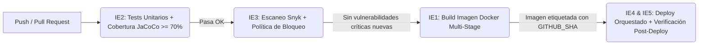

# 🚀 Microservicio de Facturación (Caso 02 - TalentoYa) — Pipeline CI/CD (EP2 DOY0101)

Repositorio correspondiente a la **Evaluación Parcial N°2** de la asignatura **Ingeniería DevOps (DOY0101)**. Este proyecto implementa un pipeline CI/CD automatizado de punta a punta en **GitHub Actions** para un microservicio desarrollado en **Java 21 con Spring Boot 3.3.5**, integrando contenerización optimizada, pruebas automatizadas, análisis de seguridad con bloqueo (*Security Gate*), despliegue continuo trazable y orquestación de contenedores.

---

## 💻 1. Descripción del Microservicio y Ejecución Local

El microservicio `facturacion-svc` gestiona la emisión, consulta y cálculo de facturas (incluyendo validación de ítems, cálculo de IVA y persistencia en base de datos en memoria H2), exponiendo una API REST documentada con OpenAPI/Swagger.

### 📋 Requisitos previos
- JDK 21 y Maven 3.9+ (para ejecución directa) o Docker y Docker Compose (para ejecución en contenedores).

### 🛠️ Comandos de ejecución local
```bash
# Ejecutar pruebas unitarias y validación de cobertura localmente
mvn clean verify

# Levantar el entorno orquestado (2 réplicas) con Docker Compose
docker compose up -d --build

# Verificar estado de los contenedores y healthchecks
docker compose ps

# Detener el entorno
docker compose down
```

---

## ⚙️ 2. Arquitectura del Pipeline CI/CD

El flujo de integración y entrega continua está definido en `.github/workflows/pipeline.yml` y se activa automáticamente en cada `push` y `pull_request` hacia las ramas `develop`, `main` y `feature/**`.

### 🔄 Diagrama del Pipeline



---

## 📊 3. Evidencia por Indicador de Evaluación (IE1 – IE5)

### 🐳 IE1 — Contenedores con Imágenes Optimizadas (20%)
Se diseñó un `Dockerfile` **multi-stage** junto con un archivo `.dockerignore` (que excluye `target/`, `.git/` y archivos temporales) para minimizar el contexto de construcción y el tamaño final de la imagen:
* **Etapa 1 (`build`):** Utiliza `maven:3.9-eclipse-temurin-21` para descargar dependencias en caché (`dependency:go-offline`) y empaquetar el artefacto `.jar`.
* **Etapa 2 (`runtime`):** Utiliza la imagen ligera `eclipse-temurin:21-jre` (únicamente entorno de ejecución, sin herramientas de compilación).
* **Seguridad de contenedor (No-Root):** Se crea y asigna el usuario sin privilegios `appuser` (`useradd -m appuser` y `USER appuser`) para evitar la ejecución como `root`.
* **Monitoreo nativo (`HEALTHCHECK`):** Verifica periódicamente cada 30 segundos que el servicio responda HTTP 200 en `http://localhost:8080/`.

### 🧪 IE2 — Pruebas Automatizadas y Políticas de Calidad en CI (20%)
El job `tests` ejecuta la suite de pruebas automatizadas del microservicio (implementadas con **JUnit 5** y **Cucumber**) mediante el comando `mvn -B clean verify`:
* **Casos críticos cubiertos:** Cálculo de montos e impuestos, validación de entradas nulas o inválidas, respuestas de endpoints HTTP y persistencia JPA.
* **Política de cobertura (JaCoCo):** El plugin `jacoco-maven-plugin` exige un mínimo de **70% de cobertura de líneas (`0.70`)**. Si una prueba falla o la cobertura cae bajo el umbral, el job retorna error y detiene inmediatamente el pipeline.
* **Evidencia:** En cada ejecución del pipeline se publica automáticamente el artefacto `reporte-cobertura-jacoco` con el detalle en HTML/XML.

### 🛡️ IE3 — Seguridad, Escalabilidad y Política de Bloqueo (20%)
La estrategia DevSecOps y de gobernanza se implementa en tres niveles:
1. **Escaneo de dependencias con Dependabot:** Configurado en `.github/dependabot.yml` con revisiones semanales (`weekly`) tanto para el ecosistema `maven` (`pom.xml`) como para `github-actions`.
2. **Análisis de seguridad en CI con Snyk y bloqueo automático (*Gating*):** El job `security` ejecuta `npx snyk test --severity-threshold=high`. Si detecta vulnerabilidades de severidad **High** o **Critical** no gestionadas, devuelve código de salida `1` y **bloquea el pipeline** antes de construir la imagen o desplegar (evidenciado en el historial de Actions).
3. **Política de Gobernanza (`.snyk`):** Se estableció una línea base auditada en el archivo `.snyk` con fecha de expiración y justificación técnica para aislar las dependencias heredadas de la plantilla académica (Spring Boot 3.3.5), manteniendo activo el bloqueo estricto ante cualquier dependencia o vulnerabilidad nueva.
4. **Parámetros de Escalabilidad:** Definidos en el orquestador con **2 réplicas** activas y cuotas estrictas de CPU y memoria por contenedor.

### 🚀 IE4 — Despliegue Automático y Trazabilidad (20%)
El job `deploy` se ejecuta únicamente si las etapas `tests`, `security` y `build` finalizan con éxito (`needs: build`):
* **Trazabilidad de extremo a extremo:** Cada imagen generada es etiquetada de forma única utilizando el identificador criptográfico del commit (`duoc/caso02-facturacion:${{ github.sha }}`) además de la etiqueta de versión `1.0.0`.
* **Despliegue en entorno cloud simulado:** El runner levanta el clúster de contenedores mediante `docker compose up -d --build` inyectando la variable `IMAGE_TAG=${{ github.sha }}`.
* **Verificación Post-Deploy:** Una vez levantadas las réplicas, el pipeline realiza peticiones HTTP reales con `curl --fail -v` contra los puertos `8080` y `8081` para certificar que ambas instancias responden correctamente.
* **Registro auditable:** El pipeline genera y almacena como artefacto descargable el archivo `evidencia-trazabilidad-<GITHUB_SHA>` (`deploy-traceability.txt`), registrando fecha UTC, autor, rama, SHA del commit, imagen desplegada y estado de las réplicas.

### 🚢 IE5 — Orquestación de Contenedores (20%)
Implementada en `docker-compose.yml` para asegurar alta disponibilidad y estabilidad:
* **Réplicas y balanceo de puertos:** Configuración de `replicas: 2` mapeadas al rango de puertos `"8080-8081:8080"`.
* **Límites y reservas de recursos (`resources`):**
  * **Límites máximos (`limits`):** `0.50` vCPU y `512M` de memoria RAM por réplica.
  * **Reservas garantizadas (`reservations`):** `0.25` vCPU y `256M` de memoria RAM por réplica.
* **Resiliencia:** Configuración de `restart: unless-stopped` y `healthcheck` automatizado (`interval: 30s`, `timeout: 5s`, `retries: 3`, `start_period: 20s`).

---

## 🤖 4. Declaración de Uso de Inteligencia Artificial (IA)

En cumplimiento con las normas de integridad académica de Duoc UC, se declara el uso de la herramienta de Inteligencia Artificial generativa **Google Gemini** como asistente de apoyo durante el desarrollo de este encargo.
* **Aplicación:** Apoyo en la revisión de sintaxis de archivos YAML para GitHub Actions, resolución de incompatibilidades de versión del compilador Java (ajuste de JDK 25 a JDK 21 LTS), estructuración de políticas de línea base en `.snyk` y maquetación visual/formato del documento Markdown (README).
* **Validación:** Código, configuraciones de contenedores y flujos del pipeline fueron ejecutados, probados y validados localmente y en GitHub Actions por los integrantes del equipo.
* **Referencia:** Google. (2026). *Gemini* (Versión 2.5 Pro) [Modelo de lenguaje grande]. [https://gemini.google.com/](https://gemini.google.com/)

---

## Observabilidad, Despliegue Orquestado y Cumplimiento (EP3)

En esta tercera etapa se extendió el pipeline CI/CD del microservicio `facturacion-svc` para incorporar observabilidad real, manifiestos listos para Kubernetes en AWS EKS, dashboards de métricas y auditoría automatizada de cumplimiento DevSecOps.

### 1. Arquitectura de Observabilidad y Nube (IE1 e IE2)

* **Instrumentación en la aplicación:** Se integraron `spring-boot-starter-actuator` y `micrometer-registry-prometheus` en `pom.xml`, exponiendo `/actuator/health`, `/actuator/metrics` y `/actuator/prometheus` junto a logs estructurados en `src/main/resources/application.yml`.
* **Orquestación en AWS EKS (`k8s/`):** Manifiestos preparados para el namespace `ep02` del clúster `laboratorio-ep02-eks`:
  * `k8s/deployment.yaml`: 2 réplicas, usuario no-root (`runAsNonRoot: true`), límites de CPU/RAM (`500m` / `512Mi`), sondas `readinessProbe` y `livenessProbe` apuntando a `/actuator/health`, y anotaciones para *scraping* de Prometheus.
  * `k8s/service.yaml`: Exposición mediante `LoadBalancer`.
  * `k8s/hpa.yaml`: Auto-escalado horizontal (`HorizontalPodAutoscaler`) entre 2 y 5 réplicas al superar el 60% de utilización de CPU.
* **Despliegue híbrido en CI/CD:** El workflow `.github/workflows/pipeline.yml` detecta si existen credenciales de AWS en GitHub Secrets para publicar en **AWS ECR**, desplegar en **AWS EKS** y actualizar el dashboard en **AWS CloudWatch**; en ausencia de sesión activa de AWS Academy, ejecuta validación completa en runner Linux con métricas y logs reales.

### 2. Dashboards y Métricas Clave en CI/CD (IE3)

* **Plantillas configuradas (`observability/`):**
  * `observability/prometheus.yml`: Recolección de métricas desde `/actuator/prometheus` cada 15 segundos (validado con `promtool`).
  * `observability/cloudwatch-dashboard.json`: Panel `ep02-observabilidad` con disponibilidad (`SaludBackend`, `PodsActivos`), CPU de nodos EKS (umbral 60%), errores HTTP `5XX` y consulta de logs del clúster.
  * `observability/grafana-dashboard.json`: Panel importable para visualizar estado `UP`, CPU JVM, memoria Heap/Non-Heap y tasa de errores `4xx/5xx`.
* **Resultados medidos en Pipeline (Ejecución `#23` — Commit `b1694d4`):**

| Métrica Clave | Valor Medido | Estado |
| :--- | :--- | :---: |
| **Tiempo de despliegue y arranque** | 76 segundos | OK |
| **Cobertura de pruebas (JaCoCo)** | 100.00% (Umbral >= 70%) | PASS |
| **Disponibilidad (`/actuator/health`)** | 2/2 réplicas UP (puertos 8080 y 8081) | UP |
| **Errores HTTP 5XX registrados** | 0 | OK |
| **Auditoría DevSecOps y K8s (IE5)** | 0 incumplimientos (`kubeconform` + `promtool`) | PASS |
| **Consumo de recursos (réplicas 1 y 2)** | CPU 0.08% – 0.17% / RAM ~226 MiB de 512 MiB (44%) | OK |

### 3. Políticas de Cumplimiento y Bloqueo Automático (IE5 e IE6)

* **Auditoría automatizada (`scripts/auditoria-cumplimiento.sh`):** Verifica en cada push la ejecución sin privilegios `root` y `HEALTHCHECK` en `Dockerfile`, sondas y límites en `k8s/deployment.yaml`, configuración de observabilidad, vigencia de Dependabot/Snyk y ausencia de credenciales filtradas (`secrets.txt` o llaves AWS).
* **Reglas de rama (`Branch Protection Rules`):** Rama `main` protegida exigiendo Pull Request y aprobación obligatoria de los jobs `tests`, `compliance` y `security`.
* **Evidencia de bloqueo efectivo (IE6):** En la ejecución `#22` (commit `14167f5`), al incorporar las dependencias de Actuator y Micrometer, el job **IE6 (Snyk)** detectó 12 vulnerabilidades `High/Critical` y detuvo automáticamente el pipeline con `exit code 1`, omitiendo el *Build* y el *Deploy*. Tras auditar y documentar la línea base en `.snyk`, la ejecución `#23` completó las 5 etapas en verde.

### 4. Toma de Decisiones Técnicas y Mejora Continua (IE4)

Una de las cosas que nos llevamos de este trabajo es entender que DevOps no termina cuando el código funciona, sino que también hay que preocuparse por su seguridad, rendimiento y estabilidad. Herramientas como Snyk, los umbrales de cobertura y CloudWatch permiten detectar problemas y tomar decisiones antes de que afecten al sistema. Por ejemplo, una alerta de seguridad, un aumento en el consumo de RAM/CPU o una métrica fuera de los límites pueden ser motivos para detener un despliegue, hacer un rollback o escalar recursos. Aunque todavía no manejo estos conceptos en profundidad, ahora entiendo mejor por qué son importantes dentro de un proyecto real.

Apreciamos mas mucho más que antes el RAM. 

### 5. Declaración de Uso Ético de Inteligencia Artificial

En el desarrollo de esta evaluación se utilizó **Google Gemini** exclusivamente como apoyo para estructurar plantillas de configuración YAML/JSON, depurar errores de sintaxis en el pipeline y apoyar la redacción técnica base. Todo el código, las configuraciones y los resultados en GitHub Actions fueron ejecutados, verificados y validados por el equipo, conforme a las orientaciones de uso ético de IA de Duoc UC (https://bibliotecas.duoc.cl/ia). Las conclusiones, justificaciones técnicas y reflexiones individuales fueron redactadas íntegramente por los estudiantes sin apoyo de IA.

### 6. Reflexiones Individuales (EP3)

### 👤 Reflexión Individual — Rodrigo Latorre
Cada vez que el proyecto escala voy encontrando más y más difícil todo el mundo de DevOps, cuando salen a la luz los temas de DevSecOps o SRE me abruma la cantidad de cosas que imagino que hay que entender.

En mi cabeza de primer semestre, uno cree que va a salir de acá sabiendo de todo, pero la verdad es que cada una de estas ramas de la programación son tan densas como si fuera una carrera nueva. Por lo demás, me gustaría señalar que no todo es malo o necesariamente difícil. La importancia que tiene esta rama de la programación para las empresas es clave, y entiendo por qué son necesarios aspectos como las evaluaciones constantes de seguridad con Snyk, la revisión de cobertura y el monitoreo de recursos mediante CloudWatch. Incluso cosas como el consumo de CPU y RAM pueden terminar siendo importantes para decidir si un sistema necesita escalar, hacer rollback o bloquear un despliegue.

### 👤 Reflexión Individual — Armin Muñoz
Durante el desarrollo de este trabajo pude conocer distintas herramientas y conceptos relacionados con DevOps que aún no manejo con mucha profundidad. Algunos temas como GitHub, los procesos de CI/CD y las herramientas de análisis de código y seguridad, como Snyk, me resultaron difíciles de comprender, principalmente porque aún no he cursado algunas asignaturas que entregan conocimientos necesarios para entender mejor estos contenidos.

Reconozco que tengo algunas dificultades y que necesito reforzar ciertos conocimientos de programación y otras materias para poder relacionar mejor los conceptos. Aun así, este trabajo me permitió acercarme a herramientas que probablemente serán importantes en mi futuro como desarrollador y comprender, al menos de manera general, cuál es su utilidad dentro de un proyecto de software. También pude entender que monitorear aspectos como la cobertura, las vulnerabilidades y el consumo de CPU y RAM permite tomar decisiones más informadas sobre los despliegues y la estabilidad de una aplicación.
